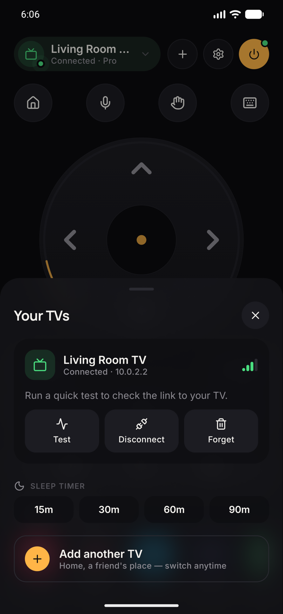
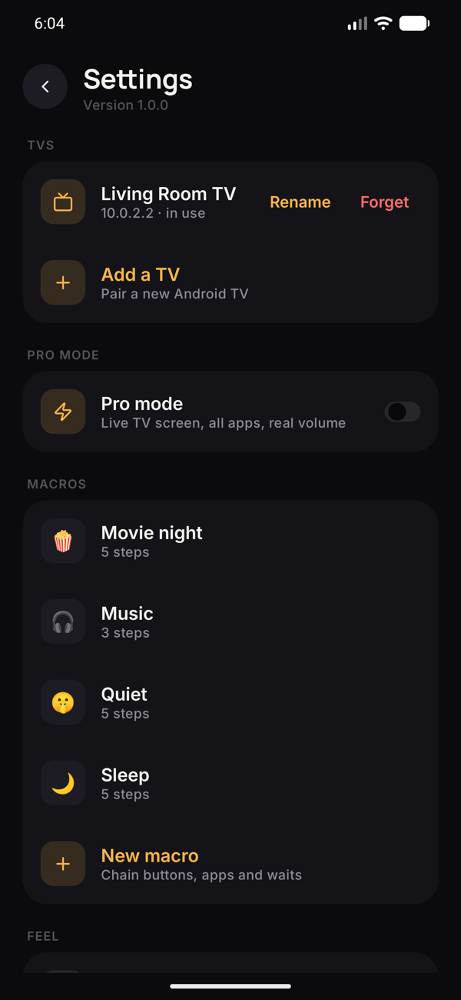

  

<h1 align="center">Clicko</h1>

  Turn your phone into a remote for any Android TV — over Wi-Fi, no IR, no account. 
  Free, no ads, no tracking.

  <a href="../../releases/latest"><b>⬇ Download the latest APK</b></a>

  
  
  

  
  
  

## Features

- **Works with old and new Android TVs.** Clicko tries every known pairing method (Android TV Remote v2 and the older v1) and remembers what your TV speaks. Tested on a Xiaomi Mi TV (Android 9).
- **Full remote:** D-pad, touchpad, volume, mute, playback, home, back, voice search, power — with a live on/off dot.
- **Type on TV** from your phone keyboard, plus a one-tap YouTube search.
- **One-tap apps:** YouTube, Netflix, Prime Video, JioHotstar, Spotify, Play Store.
- **Macros:** chain buttons, apps and waits ("Movie night", "Quiet"…).
- **Phone hotspot friendly:** works when the TV is connected to your phone's hotspot.
- **Several TVs:** home, bedroom, a friend's place — switch any time.
- **Pro mode (optional, via ADB):**
  - **Live TV screen** on your phone, in HD (the TV's own resolution), with full-screen landscape.
  - Real volume slider, every installed app, close the current app, TV info.

## Install

1. On your phone, open the [latest release](../../releases/latest) and download `Clicko-x.y.z.apk`.
2. Open it. Android asks to allow installs from your browser → **Allow** → **Install**.
3. Open Clicko → **+** → pick your TV → type the code shown on the TV.

Your phone and TV need to be on the same Wi-Fi (or the TV on your phone's hotspot).

### Updates
Clicko checks this page for new versions. When one is out, it downloads in the background and shows **Update** — one tap, and your TVs and settings stay as they are.

## Pro mode (optional)

Pro mode uses ADB, Android's built-in developer connection, to add the live screen and full app control. The normal remote never needs it.

1. On the TV: **Settings → Device preferences → About** → click **Build** 7 times.
2. **Developer options** → turn on **USB / ADB debugging** (and **Network debugging** if listed).
3. In Clicko: **Settings → Pro mode** → on. Accept **Allow debugging?** on the TV with **Always allow**.

Android 11+ TVs with only *Wireless debugging* can pair from the same screen.

> Netflix, Hotstar and other DRM apps show black in the live screen — Android blocks capturing protected video.

## How it works

| Part | How |
|---|---|
| Remote buttons, typing, app links | Google's Android TV Remote protocol (v2 protobuf on ports 6466/6467; v1 JSON for older TVs), TLS with a per-phone certificate |
| Pro mode | ADB over Wi-Fi via [Kadb](https://github.com/Flyfish233/Kadb) |
| Live screen | The TV's hardware encoder streams H.264 (`screenrecord`); the phone decodes it with `MediaCodec` |
| App | Kotlin, Jetpack Compose, Material 3 |

## Privacy

No account, no analytics, no ads. Everything stays between your phone and your TV on your own network. The only internet request is the update check to this GitHub page.

## License

MIT
