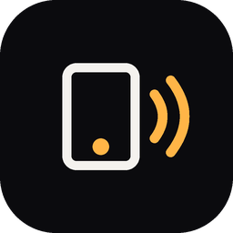
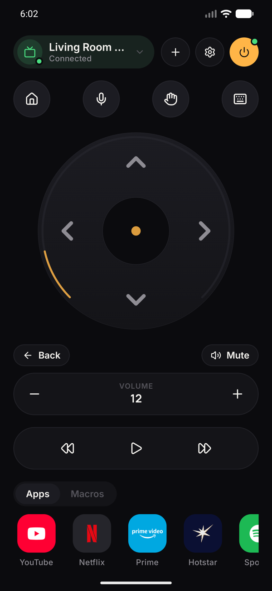
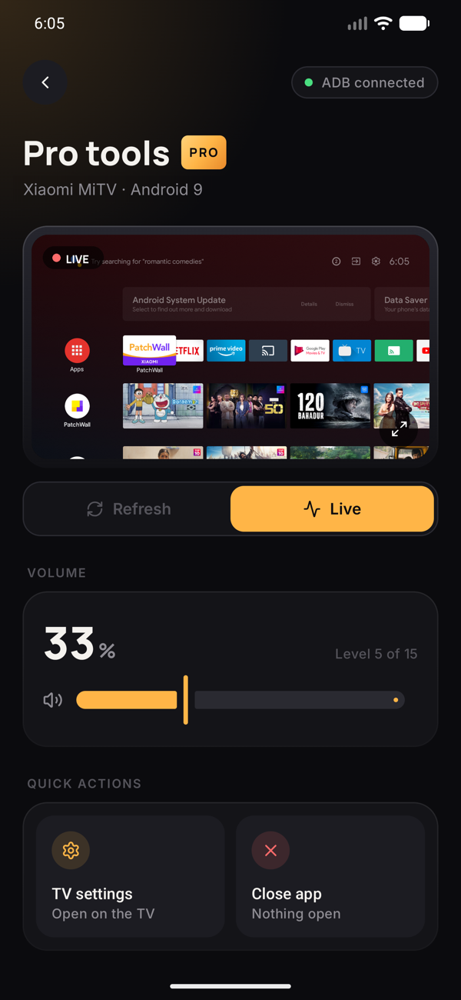
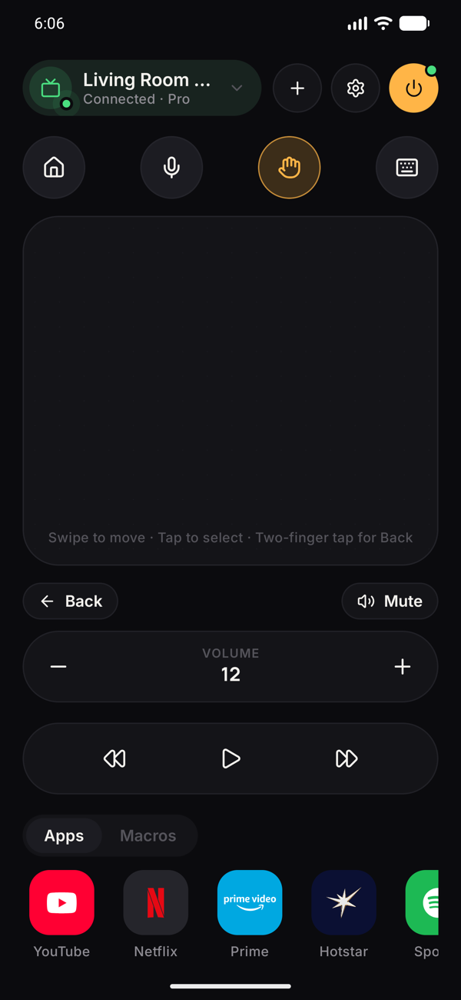
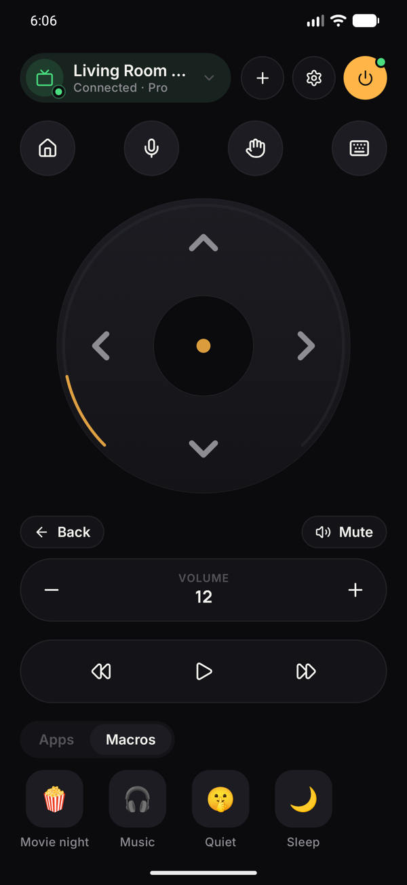

  

<h1 align="center">Clicko</h1>

<h3 align="center">Your phone is the remote now.</h3>

  Control your Android TV from your phone over Wi-Fi. 
  No IR blaster. No lost remotes. No dead batteries. No ads. Free.

  
  &nbsp;
  
  &nbsp;
  

  
  
  

---

## 📺 Works with your TV — old or new

Xiaomi Mi TV, Sony, TCL, OnePlus, Philips, Haier, Google TV, Chromecast with Google TV, Android TV boxes…
If it runs **Android TV or Google TV**, Clicko talks to it — from brand-new models down to TVs that are years old.

Just be on the same Wi-Fi. Or turn on your phone's **hotspot** and connect the TV to it — Clicko works there too.

---

## ✨ What you get

### 🎮 A remote that feels better than the real one
Round D-pad, volume, mute, play/pause, rewind, home, back and power — big, smooth, with a little buzz on every press.
The power button even shows a **green dot when your TV is on**.

### 👆 Touchpad mode
Swipe to move, tap to select — like a laptop trackpad for your TV.

### 🎙️ Voice search
One tap opens your TV's voice search. Just say what you want to watch.

### ⌨️ Type from your phone
Forget hunting letters with arrow keys. Type on your phone's keyboard and the words **appear on the TV as you type** —
search YouTube, Hotstar, Netflix, Prime, Wi-Fi passwords, anything.
One tap **Search YouTube** jumps straight to results.

### 🚀 Apps in one tap
YouTube · Netflix · Prime Video · JioHotstar · Spotify · Play Store — open them instantly, no scrolling.

### 🏠 All your TVs
Living room, bedroom, a friend's place. Pair once, switch any time.

---

## ⚡ Pro mode — superpowers for your TV

Turn on Pro mode once and Clicko unlocks things no normal remote can do:

  

- 📡 **Live TV on your phone** — watch your TV's screen live on your phone, in **HD**. Go **full-screen landscape** and it's a second TV in your hand.
- 🔊 **Real volume slider** — see the exact level and drag to set it.
- 📱 **Every app on your TV** — the full list with logos. Tap to open, hold to close.
- ⚙️ **TV settings in one tap** — jump straight into the TV's settings panel.
- ❌ **Close stuck apps** — force-close whatever's frozen on screen.
- ℹ️ **TV details** — brand, model, Android version and free storage at a glance.

*How to turn it on:* TV **Settings → About → click "Build" 7 times**, then **Developer options → turn on USB / ADB debugging**. In Clicko: **Settings → Pro mode** → accept **"Allow debugging?"** on the TV with **Always allow**. Done, forever.

> 🔒 Netflix, Hotstar and other protected apps show black in the live view — that's Android protecting their videos, not a bug.

---

## 🪄 Create your own macros

**One tap. A whole routine.**

Chain buttons, apps, text and waits into your own shortcut:

  

| Macro | What one tap does |
|---|---|
| 🍿 **Movie night** | Opens Netflix → turns the volume up for the film |
| 🎧 **Music** | Opens YouTube → straight to search |
| 🤫 **Quiet** | Brings the volume down five steps |
| 🌙 **Sleep** | Goes home → switches the TV off |

Make your own: **Settings → Macros → New macro**. Your TV, your routine.

---

## ⬇️ Install in 30 seconds

1. On your phone, open the **[latest release](../../releases/latest)** and download **`Clicko-x.y.z.apk`**.
2. Open it → Android asks to allow installs → **Allow** → **Install**.
3. Open Clicko → **+** → tap your TV → type the code shown on the TV screen.

That's it — you're in control. 🎉

**Updates are automatic:** when a new version is out, Clicko downloads it quietly and shows an **Update** button. One tap, and your TVs and settings stay exactly as they were.

---

## 🛡️ Private by design

- No account, no sign-up
- No ads, no tracking, no analytics
- Everything stays between your phone and your TV, on your own Wi-Fi

---

  Made with ☕ in India · <a href="LICENSE">MIT License</a> 
  If Clicko made your couch life easier, give it a ⭐

